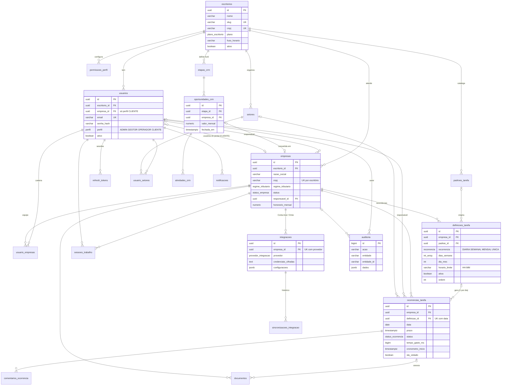

# Modelagem do banco de dados

PostgreSQL 16, versionado com **Flyway**. A fonte da verdade são as migrations SQL em [`src/main/resources/db/migration/`](../src/main/resources/db/migration/) (a primeira é [`V1__schema_inicial.sql`](../src/main/resources/db/migration/V1__schema_inicial.sql), com comentários em tabelas e colunas). As entidades JPA espelham esse schema, e o Hibernate apenas **valida** o mapeamento ao subir (`ddl-auto: validate`): ele nunca altera o banco.

## Decisões

| Tema | Decisão | Motivo |
| --- | --- | --- |
| Multi-tenancy | Banco e schema compartilhados; toda tabela de negócio tem `escritorio_id` (FK para `escritorios`) | Simples de operar e migrar; o isolamento é aplicado na API a partir do token. Evolução natural: Row Level Security no Postgres usando o mesmo campo. |
| Chaves | UUID (`gen_random_uuid()` no banco, gerado pela aplicação via JPA) em todas as tabelas, exceto `auditoria` (`bigserial`, alto volume e só inserção) | IDs não sequenciais não expõem volume nem permitem enumeração entre tenants. |
| Nomes | Tabelas e colunas em `snake_case` português; entidades Java em `PascalCase`/`camelCase` | Consistente com o frontend e legível em SQL puro. |
| Enumerações | `VARCHAR` + `CHECK` (no Java, `@Enumerated(STRING)`) | Valor legível no banco; incluir um valor novo é só trocar o `CHECK` numa migration. |
| Datas | `DATE` para competência (`data`, `data_inicio`), `TIMESTAMPTZ` para instantes (sempre em UTC na aplicação) | Prazo é um instante; a "data da tarefa" não tem fuso. O fuso de cada escritório fica em `escritorios.fuso_horario`. |
| Concorrência | `ocorrencias_tarefa.versao` (`@Version`, bloqueio otimista) | Duas pessoas mexendo no cronômetro da mesma tarefa: a segunda recebe 409 em vez de sobrescrever. |
| Regras no banco | `CHECK`s e índices parciais para invariantes (ver abaixo) | A regra vale mesmo para scripts e integrações que não passam pela API. |
| Dinheiro | `NUMERIC(12,2)` | Sem erro de arredondamento de ponto flutuante. |
| Exclusão | `ON DELETE CASCADE` a partir do tenant e da empresa; `SET NULL` para referências a usuários | Remover um escritório remove tudo dele; desligar um usuário não apaga o histórico. Cadastros principais usam desativação (`ativo`/`status`) em vez de exclusão. |
| Segredos | Senhas com bcrypt; refresh tokens guardados só como hash SHA-256; credenciais de ERP cifradas com AES-256-GCM | Um vazamento do banco não entrega credenciais utilizáveis. |

## Diagrama entidade-relacionamento

Todas as entidades abaixo (exceto `refresh_tokens` e as tabelas de junção) também se ligam a `escritorios` por `escritorio_id`; essas ligações foram omitidas para o diagrama continuar legível.



## Domínios e tabelas

### Tenant, identidade e acesso
- **`escritorios`** — o tenant. Cada escritório de BPO/contabilidade é um ambiente isolado.
- **`usuarios`** — equipe do escritório e usuários do portal. `perfil = CLIENTE` exige `empresa_id`; o e-mail é único na plataforma (o login não pede o escritório).
- **`permissoes_perfil`** — matriz perfil × módulo (`leitura`/`escrita`) por escritório; espelha o `can(mod)` do frontend. ADMIN tem acesso total sem precisar de linhas.
- **`refresh_tokens`** — sessões com rotação; reusar um token já rotacionado revoga todas as sessões do usuário.

### Organização
- **`setores`** — Financeiro, Contábil, Fiscal, Departamento Pessoal (criados por padrão, configuráveis).
- **`usuario_setores`** — N:N usuário × setor.
- **`usuario_empresas`** — carteira: quais empresas um OPERADOR atende (`podeEmpresa` no frontend). ADMIN e GESTOR veem todas.

### Clientes
- **`empresas`** — clientes do escritório. O CNPJ é guardado normalizado (14 caracteres) e aceita o formato alfanumérico que a Receita adota em 2026; é único por escritório.
- **`checklist_itens`** (V3) — checklist dentro do cliente: observações pontuais com prazo, prioridade e responsável opcionais (ex.: "Cliente pendente de envio do acesso bancário"). `concluido` e `concluido_em` andam juntos (restrição `ck_checklist_conclusao`).
- **`checklist_subitens`** (V3) — passos de um item do checklist, apagados em cascata com o item.
- **`checklist_modelo_itens`** e **`checklist_modelo_subitens`** (V4) — checklist modelo do escritório (`escritorio_id` no item; sub-itens apagados em cascata). `prazo_dias` (0 a 365, opcional) vira o prazo da cópia: data de criação da empresa + dias. O modelo não tem responsável. Toda empresa nova (cadastro ou conversão do CRM) recebe uma cópia dos itens em `checklist_itens`/`checklist_subitens`, sem vínculo com o modelo: alterar o modelo depois não muda as cópias nem as empresas existentes.
- **`senhas_empresa`** (V3) — acessos do cliente que o escritório usa na gestão financeira (bancos, certificado digital, portais, prefeitura, ERP). A senha fica em `senha_cifrada` (AES-256-GCM com `ENCRYPTION_KEY`), nunca sai em listagens e cada visualização é auditada (`senha.revelar`). Protegida pelo módulo `SENHAS` da matriz de permissões.

### Operação (tarefas)
O fluxo tem três níveis:

1. **`padroes_tarefa`** — catálogo reutilizável do escritório (ex.: "Conciliação bancária, diária, até 12h").
2. **`definicoes_tarefa`** — a recorrência configurada para uma empresa, normalmente copiada de um padrão e depois ajustada (responsável, horário, ordem). Equivale a `db.defs` no frontend.
3. **`ocorrencias_tarefa`** — a instância de um dia, que a equipe executa. Uma rotina agendada gera as ocorrências do dia; a restrição única `(definicao_id, data)` torna a geração idempotente. Tarefas avulsas têm `definicao_id` nulo.

Regras da ocorrência:
- **Prazo (SLA de entrega):** `data` + `horario_limite`, no fuso do escritório. `sla_violado` é marcado por uma varredura a cada minuto quando o prazo passa sem conclusão, ou na conclusão após o prazo.
- **Cronômetro:** `tempo_gasto_ms` acumula os intervalos já encerrados; `cronometro_inicio` indica um intervalo em andamento. O tempo total = acumulado + (agora − início).
- **`tempo_estimado_min`:** meta de execução, usada nos relatórios de produtividade.
- **`visivel_cliente`:** controla o que aparece no portal do cliente.

Tabelas de apoio: **`comentarios_ocorrencia`**, **`documentos`** (documentos da empresa; com `ocorrencia_id` viram anexos de uma tarefa; o arquivo fica no armazenamento e a tabela guarda `storage_key` e `sha256`) e **`sessoes_trabalho`** (tempo em que o usuário esteve "dentro" de uma empresa). As sessões alimentam o **contador geral** de Tarefas do dia: entrar em uma empresa abre uma sessão; trocar de empresa ou finalizar encerra a anterior (índice único parcial `uq_sessoes_aberta_usuario`). `GET /sessoes/resumo` soma o dia e `GET /sessoes/rentabilidade` compara horas × honorário por cliente.

### CRM
- **`etapas_crm`** — colunas do funil; `tipo` (`ABERTA`, `GANHA`, `PERDIDA`) dá significado às etapas sem depender do nome.
- **`oportunidades_crm`** — negócios em prospecção; ao converter uma oportunidade ganha, cria-se a `empresa` e ela é vinculada por `empresa_id`.
- **`atividades_crm`** — ligações, reuniões, e-mails e notas.

### Integrações
- **`integracoes`** — uma conexão por empresa e provedor (`CONTA_AZUL`, `OMIE`), com credenciais cifradas e `configuracoes` em JSONB.
- **`sincronizacoes_integracao`** — histórico de cada execução (recurso, status, registros, erro).

### Rastreabilidade
- **`notificacoes`** — avisos por usuário (atribuição, SLA, comentários, documentos).
- **`auditoria`** — trilha de quem fez o quê (`acao` no padrão `entidade.verbo`, como no `audit()` do frontend), com `dados` em JSONB. Só recebe inserções.

## Índices principais

| Tabela | Índice | Consulta atendida |
| --- | --- | --- |
| `ocorrencias_tarefa` | `(escritorio_id, data, status)` | Quadro do dia do escritório |
| `ocorrencias_tarefa` | `(escritorio_id, empresa_id, data)` | Tarefas de uma empresa |
| `ocorrencias_tarefa` | `(responsavel_id, status)` | "Minhas tarefas" |
| `ocorrencias_tarefa` | `(prazo)` parcial: só abertas e ainda sem `sla_violado` | Varredura de SLA a cada minuto, sem varrer o histórico |
| `definicoes_tarefa` | `(escritorio_id, empresa_id, ativa, ordem)` | Lista ordenável (arrastar e soltar) |
| `auditoria` | `(escritorio_id, criado_em DESC)` | Linha do tempo de auditoria |
| `notificacoes` | `(usuario_id, lida_em, criado_em DESC)` | Sino de notificações |

## Invariantes garantidas pelo banco

| Constraint | Regra |
| --- | --- |
| `ck_usuarios_empresa_cliente` | Usuário CLIENTE sempre tem `empresa_id`; usuário da equipe nunca tem. |
| `uq_empresas_cnpj` | CNPJ único por escritório (o mesmo cliente pode existir em escritórios diferentes). |
| `uq_ocorrencias_definicao_data` | Uma ocorrência por definição e data: a geração diária pode rodar várias vezes sem duplicar. |
| `ck_ocorrencias_cronometro` | Cronômetro só pode estar rodando em tarefa `EM_ANDAMENTO`. |
| `uq_sessoes_aberta_usuario` (índice parcial) | No máximo uma sessão de trabalho aberta por usuário. |
| `uq_integracoes_empresa_provedor` | Uma conexão por empresa e ERP. |
| `CHECK`s de formato | `horario_limite` em `HH:MM`, `dia_mes` entre 1 e 31, valores de enumeração, `tempo_gasto_ms >= 0`. |

## Como evoluir o schema

1. Crie um arquivo novo em `src/main/resources/db/migration/` seguindo a sequência: `V2__descricao_curta.sql`, `V3__...`.
2. **Nunca edite uma migration já aplicada** em algum ambiente; o Flyway confere o checksum e recusa a inicialização.
3. Ajuste a entidade JPA correspondente. Ao subir, o Hibernate valida o mapeamento e aponta qualquer divergência.

```bash
./mvnw spring-boot:run                                         # aplica migrations pendentes e sobe a API
./mvnw spring-boot:run -Dspring-boot.run.profiles=dev,seed     # idem + recria o escritório de demonstração
docker compose --profile tools up -d adminer                   # cliente SQL web em http://localhost:8081
```

Para recriar o banco local do zero: `docker compose down -v && docker compose up -d db` (apaga o volume com todos os dados locais).

## Próximos passos sugeridos
- **Row Level Security** no Postgres com `SET app.escritorio_id` por transação, como segunda barreira de isolamento.
- **Feriados** nacionais e municipais na geração de recorrências (hoje só fins de semana são considerados).
- **Particionamento** de `auditoria` e `ocorrencias_tarefa` por mês quando o volume crescer.
